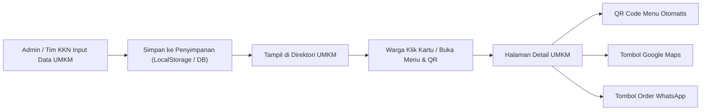
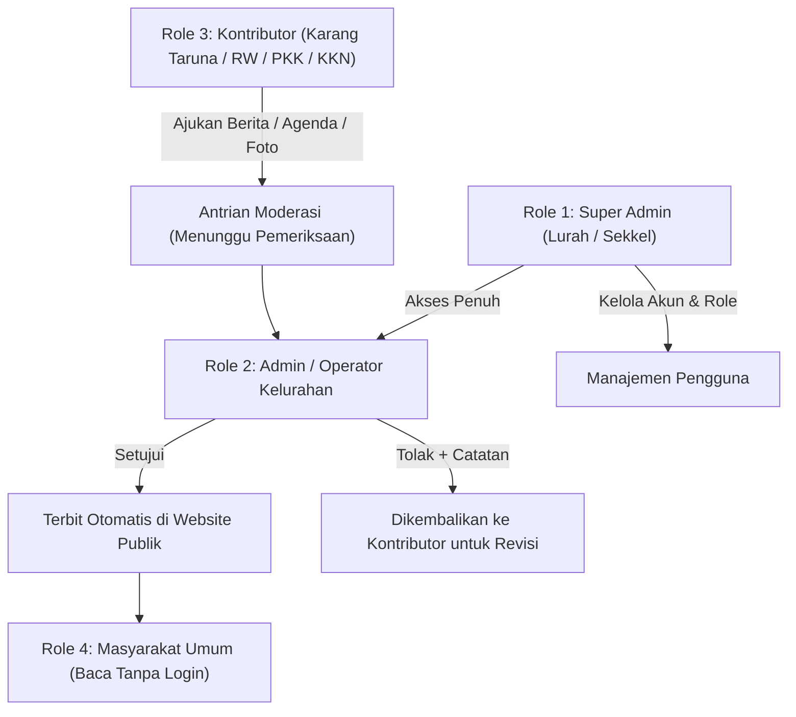
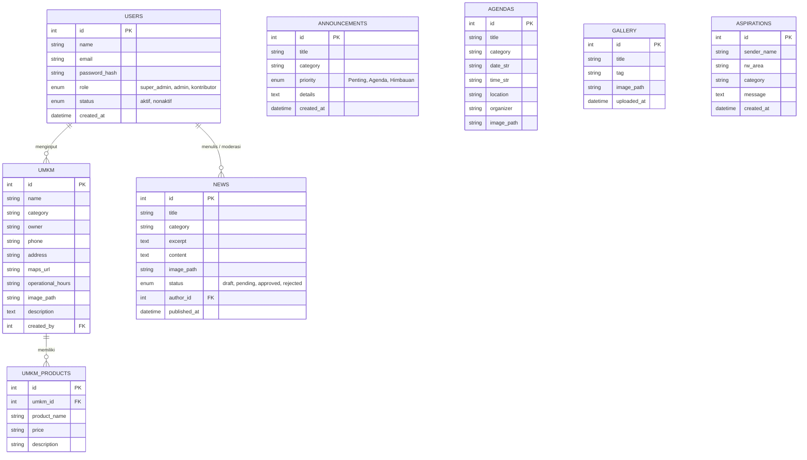

# LAPORAN PENGEMBANGAN & ARSITEKTUR SISTEM
## PORTAL DIGITAL KELURAHAN TAMBANGAN, KECAMATAN MIJEN, KOTA SEMARANG

**Program:** KKN Tematik Periode 38 Universitas Wahid Hasyim Semarang  
**Mitra:** Pemerintah Kelurahan Tambangan, Kecamatan Mijen, Kota Semarang, Jawa Tengah  
**Status:** Prototype Siap Paparan & Rencana Eksekusi Produksi  

---

## 1. Ringkasan Eksekutif
Website Kelurahan Tambangan dirancang sebagai **Portal Informasi Digital Resmi** yang permanen dan dapat terus dikelola oleh perangkat kelurahan setelah masa KKN berakhir. Mengusung konsep **Hybrid Government + Community-Centered Design**, portal ini memadukan wibawa resmi pemerintahan (Deep Navy `#0A1431` & Gold `#F5A31A`) dengan kemudahan akses informasi bagi masyarakat (Warm White `#F8F9FC`).

### Fitur Utama yang Sudah Berjalan (Prototype)
1. **14 Halaman Publik Terintegrasi:** Beranda, Profil, Pemerintahan, Layanan Administrasi (dengan pencarian & filter), Berita, Detail Berita, Pengumuman, Agenda, Direktori UMKM, Detail UMKM Interaktif, Lingkungan & Sampah, Kesehatan & Posyandu, Pendidikan & Keagamaan, Olahraga & Komunitas, Galeri (dengan filter kategori), dan Kontak/Aspirasi.
2. **Direktori UMKM Digital:** Setiap kartu UMKM dapat diklik menuju halaman khusus yang menampilkan **Daftar Menu & Harga**, **QR Code / Barcode Otomatis**, **Tautan Google Maps**, serta **Tombol Pesan WhatsApp Langsung**.
3. **Dashboard Admin (13 Menu):** Pengelolaan Berita, Pengumuman, Agenda, Galeri, UMKM (Tambah, Edit, Hapus), Profil, Layanan, Antrian Moderasi Konten, Manajemen User, Role & Permission, Pengaturan Website, dan Log Aktivitas.

---

## 2. Alur-Alur Sistem (System Flows)

### A. Alur Layanan Informasi Publik (Masyarakat)
1. Warga membuka portal utama → langsung melihat **Hero Banner**, **Jam Pelayanan**, **Statistik**, **Layanan Unggulan**, **Berita**, **Agenda**, dan **UMKM**.
2. Untuk mengurus surat, warga masuk ke menu **Layanan** → mencari jenis surat (misal: SKU, SKTM, Domisili) → klik **Lihat Persyaratan Lengkap** → muncul modal berisi daftar berkas, estimasi waktu, dan biaya (**Gratis Rp0**).

### B. Alur Direktori UMKM Digital

### C. Alur Moderasi Konten (4 Role Pengguna)

---

## 3. Entity Relationship Diagram (ERD) — Rancangan Database Produksi

---

## 4. Rekomendasi Tech Stack (Tahap Produksi / Hosting)

Saat ini website berjalan sebagai **Frontend Prototype (HTML5, CSS3, Vanilla JS + LocalStorage)** agar ringan dan cepat dipresentasikan. Untuk tahap **eksekusi menjadi website sungguhan (online & multi-user)**, berikut opsi tech stack yang paling cocok untuk tim Teknik Informatika & pemeliharaan jangka panjang oleh pihak Kelurahan:

| Komponen | Opsi 1: Full-Stack Klasik (Paling Mudah Dikelola Kelurahan) | Opsi 2: Modern JS / Serverless (Cepat & Gratis Tier) |
| :--- | :--- | :--- |
| **Frontend** | HTML5, CSS3, Vanilla JS / Tailwind CSS | React / Next.js atau Vanilla JS + Vite |
| **Backend / API** | **PHP (Laravel / Native)** | **Node.js (Express)** atau **Supabase** |
| **Database** | **MySQL / MariaDB** | **PostgreSQL (Supabase)** |
| **Autentikasi** | Session / JWT Auth (4 Role) | Supabase Auth / JWT |
| **Penyimpanan Gambar** | Folder `/uploads` di Server Hosting | Cloudinary / Supabase Storage |
| **QR Code** | Library JS (`qrcode.js`) atau API | Library JS (`qrcode.js`) |
| **Hosting & Domain** | Hosting cPanel + Domain `.semarangkota.go.id` / `.id` | Vercel / Netlify + Supabase |

> **Rekomendasi untuk Tim KKN:** Gunakan **Opsi 1 (PHP + MySQL)** jika kelurahan sudah memiliki server/cPanel pemerintahan, atau **Opsi 2 (Frontend saat ini + Supabase)** jika ingin cepat online, gratis biaya server awal, dan langsung memiliki database + login sungguhan tanpa setup server rumit.

---

## 5. Pembagian Tugas Tim (4 Mahasiswa Teknik Informatika)

Agar pengembangan berjalan paralel dan terstruktur, berikut pembagian peran untuk 4 anggota tim:

| No | Nama Mahasiswa | Peran Utama | Tanggung Jawab Teknis |
| :-: | :--- | :--- | :--- |
| **1** | **MUHAMAD AYDIN ALHAFIZ** | **Project Lead & Full-Stack Integrator** | Koordinasi tim, komunikasi dengan pihak Kelurahan, integrasi API/Database, setup autentikasi 4 Role, serta deployment/hosting akhir. |
| **2** | **RASYID RASIDI** | **Frontend & UI/UX Developer** | Penyempurnaan tampilan publik (14 halaman), responsivitas Mobile/Tablet/Desktop, optimasi aset gambar lokal, serta halaman Detail UMKM (QR & Maps). |
| **3** | **DZIHAN ZAHRIL MUSTHOFA** | **Backend & Database Engineer** | Perancangan & implementasi database (ERD: tabel `users`, `umkm`, `umkm_products`, `news`, `agendas`, `announcements`), pembuatan API CRUD, dan sistem upload gambar. |
| **4** | **HUSSAIN ABID** | **Admin Dashboard & QA/Testing** | Pengembangan fitur Dashboard Admin (13 menu), alur moderasi konten (Draft → Review → Publish), pengujian seluruh tombol/form, serta penyusunan dokumentasi/panduan operator kelurahan. |
